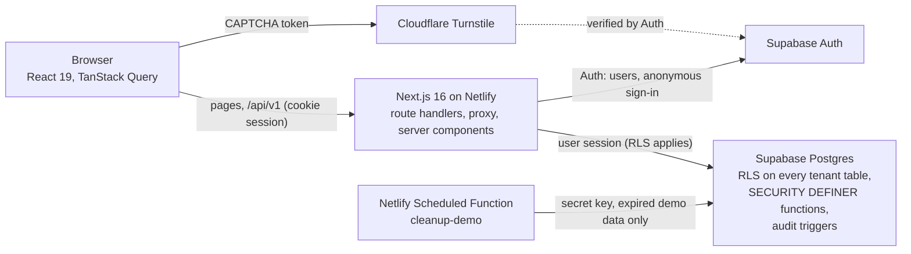

# OpsDesk

A multi-tenant business operations SaaS (customers, sales pipeline, tasks, quotes, reports) built as an engineering portfolio project: Next.js and Supabase, with the security model (row level security, roles, an isolated public demo) and the test suites as the point of the exercise.

**Status, stated plainly:** every P0 and P1 feature below is built and tested on a local stack. **Nothing is deployed yet.** The intended production origin is `https://opsdesk.sitelaunch.dev`; the Netlify site, the DNS record and the hosted Supabase project need the owner (see [`docs/PROGRESS.md`](docs/PROGRESS.md), "Waiting on Jake"). There is no live link and no deployment to verify, so none is claimed.

## What it does

| Area                         | What is built                                                                                                                                                                                   |
| ---------------------------- | ----------------------------------------------------------------------------------------------------------------------------------------------------------------------------------------------- |
| Public site                  | Landing page, privacy and terms pages, a one-click **Try Live Demo** (anonymous guest session, no sign-up)                                                                                      |
| Accounts and workspaces      | Sign up, log in, password reset, workspaces, owner / admin / member / viewer roles, invitations                                                                                                 |
| Customers                    | List with search, filters, sort and pagination; create, edit, archive and restore; tags, notes, related records; CSV import with preview and row errors; CSV export                             |
| Pipeline                     | Opportunities as a kanban board (drag and keyboard moves) and a list; won and lost with reasons; weighted pipeline                                                                              |
| Tasks                        | Lists, due dates, priority, assignment, completion, overdue and due-soon views                                                                                                                  |
| Quotes                       | Line items, tax and discount math in integer cents, statuses, revisions, locked once sent, PDF download                                                                                         |
| Dashboard, reports, activity | KPI cards from real queries, charts, date-range reports with CSV export, an activity timeline written by database triggers                                                                      |
| Public demo                  | Each visitor gets an isolated, fictional workspace that expires after 24 hours, can be reset, has caps, and is cleaned up by a scheduled job                                                    |
| Quality                      | WCAG 2.2 AA checked in a real browser (axe, both themes) and with Lighthouse, 375 px and 200% zoom passes, keyboard-only walkthroughs, request ids on every API error, structured redacted logs |

Not built and off by default (P2, optional): document attachments, Stripe test mode, e-mail notifications, AI summaries, an external CRM connector.

## Architecture



- Every request to a tenant table runs as the signed-in user, so row level security is the enforcement point; the server key is used only by the demo cleanup and a few guarded operations.
- `/api/v1` answers with one envelope (`{ data, meta }` or `{ error: { code, message, requestId } }`), and every response carries `X-Request-Id`.
- More: [`docs/ARCHITECTURE.md`](docs/ARCHITECTURE.md), [`docs/SECURITY.md`](docs/SECURITY.md) (threat model, role table, test map), [`docs/DEMO.md`](docs/DEMO.md), [`docs/API.md`](docs/API.md) and [`docs/openapi.yaml`](docs/openapi.yaml).

## Screenshots

None yet. Real screenshots or a screen recording of the running app are added by the owner once it is deployed or recorded locally; none are invented here.

## Quick start

Requires Node 24 (see `.nvmrc`), npm 11 and Docker.

```bash
nvm use
npm ci
cp .env.example .env.local        # then fill in the local Supabase values printed by the next command
npm run db:start                  # local Supabase: Postgres, Auth, Studio, mail catcher
npm run db:reset                  # apply the migrations and the seed
npm run dev                       # http://localhost:3000
```

`npm run check` (lint, format, types, unit, database, integration, build, bundle scan, end-to-end) is the gate before pushing. The test suites and what each covers are mapped in [`docs/TEST_MAP.md`](docs/TEST_MAP.md); measured results (test counts, Lighthouse scores, performance numbers) are in [`docs/PROGRESS.md`](docs/PROGRESS.md).

## Demo limitations

The public demo is a fictional, single-visitor workspace: it lasts 24 hours from creation and is read-only after that, has per-entity caps, simulates sending a quote instead of sending anything, and cannot invite members or import beyond a small limit. Sample data is fictional. See [`docs/DEMO.md`](docs/DEMO.md).

## Deploying

Netlify (free plan) with the custom domain `opsdesk.sitelaunch.dev` added as a CNAME **only** for the `opsdesk` name; the apex site, `www`, mail and name servers are never touched. The Supabase Site URL and redirect allowlist are set to that origin. The exact steps, the verification commands and rollback are in [`docs/DEPLOYMENT.md`](docs/DEPLOYMENT.md); none of it has been done yet.

## Project docs

- [`docs/IMPLEMENTATION_PLAN.md`](docs/IMPLEMENTATION_PLAN.md): every P0 and P1 feature mapped to files, migrations, tests, and Linear issues.
- [`docs/PROGRESS.md`](docs/PROGRESS.md): real check results per issue and milestone, and what is waiting on the owner.
- [`docs/DECISIONS.md`](docs/DECISIONS.md): every deviation from the PRD and why.
- [`docs/ARCHITECTURE.md`](docs/ARCHITECTURE.md): design tokens, app shell, route map, accessibility checklist.
- [`docs/SECURITY.md`](docs/SECURITY.md): threat model, roles, and which test proves each rule.
- [`docs/API.md`](docs/API.md) and [`docs/openapi.yaml`](docs/openapi.yaml): the `/api/v1` conventions and every implemented route.
- [`docs/DEMO.md`](docs/DEMO.md): demo isolation, expiry, reset, cleanup, Turnstile keys.
- [`docs/DEPLOYMENT.md`](docs/DEPLOYMENT.md): Netlify setup, DNS, Supabase Auth URLs, health check, triage runbook.
- [`docs/CI.md`](docs/CI.md): the CI jobs and required checks.
- [`docs/TEST_MAP.md`](docs/TEST_MAP.md), [`docs/API_TEST_COVERAGE.md`](docs/API_TEST_COVERAGE.md): what tests exist and what they map to.

## Commands

| Command                           | Purpose                                                                                                                                         |
| --------------------------------- | ----------------------------------------------------------------------------------------------------------------------------------------------- |
| `npm run dev`                     | Start the dev server                                                                                                                            |
| `npm run build` / `start`         | Production build / serve it                                                                                                                     |
| `npm run lint`                    | ESLint                                                                                                                                          |
| `npm run format` / `format:check` | Prettier write / check                                                                                                                          |
| `npm run typecheck`               | `next typegen && tsc --noEmit` (strict)                                                                                                         |
| `npm run test:unit`               | Vitest (jsdom + Testing Library)                                                                                                                |
| `npm run test:coverage`           | Vitest with v8 coverage                                                                                                                         |
| `npm run test:db`                 | pgTAP tests in `supabase/tests` against the local database (run `npm run db:start` first)                                                       |
| `npm run test:integration`        | API and database integration tests over real HTTP against the local Supabase stack (builds the app if needed)                                   |
| `npm run test:e2e`                | Playwright end-to-end tests against a production build; scans the server's log output for leaks when it finishes                                |
| `npm run test:e2e:scenarios`      | PRD end-to-end scenarios 1 to 6 together; `test:e2e:scenarios-7-10` runs 7 to 10                                                                |
| `npm test`                        | Unit, database, integration and end-to-end tests                                                                                                |
| `npm run check`                   | Everything above plus lint, types, build and the bundle secret scan; stops at the first failure                                                 |
| `npm run check:env`               | Fails if a `NEXT_PUBLIC_*` name contains `SECRET`, `SERVICE` or `WEBHOOK`                                                                       |
| `npm run check:bundle`            | After a build, fails if a server-only variable name or value is in `.next/static`                                                               |
| `npm run mutation:security`       | Breaks the RLS and grants on purpose, one change at a time, and shows the tests that catch each (also `mutation:membership`, `mutation:quotes`) |
| `npm run smoke:routes`            | Hits every PRD route on a running server (`-- http://host:port`, `--flags-on`)                                                                  |
| `npm run db:start` / `db:stop`    | Start/stop the local Supabase stack (needs Docker)                                                                                              |
| `npm run db:reset`                | Rebuild the LOCAL database from migrations and `supabase/seed.sql`                                                                              |
| `npm run db:types`                | Regenerate TypeScript types from the local database                                                                                             |
| `npm run demo:seed`               | Create a throwaway demo workspace with the fictional sample data in the LOCAL database                                                          |
| `npm run demo:cleanup`            | Remove expired demo workspaces and their guests (local by default; a remote project needs `--confirm-remote`)                                   |

Two audits are off by default because they take minutes and depend on the machine: `LIGHTHOUSE=1 node scripts/e2e.mjs e2e/lighthouse.spec.ts --project=desktop` and `PERF=1 node scripts/e2e.mjs e2e/performance.spec.ts --project=desktop`.

## Local Supabase

Requires Docker (or Podman) running (on macOS the npm scripts find Docker Desktop's `docker` in `~/.docker/bin` automatically; add it to your PATH to use the `supabase` CLI directly), plus the project's pinned Supabase CLI (installed by `npm ci`).

```bash
npm run db:start     # Postgres, Auth, Studio. Prints local URLs and keys.
npm run db:reset     # apply supabase/migrations/* then supabase/seed.sql
npm run db:types     # write src/lib/supabase/database.types.ts from the local schema
npm run db:stop
```

- Studio: http://127.0.0.1:54323, API: http://127.0.0.1:54321, Postgres: `127.0.0.1:54322`.
- `db:reset` refuses to run if `NEXT_PUBLIC_SUPABASE_URL`, `SUPABASE_DB_URL`, `DATABASE_URL` or `POSTGRES_URL` point at a non-local host, or if `--linked` / `--db-url` is passed.
- Migrations are forward-only files in `supabase/migrations/` named `<timestamp>_<name>.sql`; create one with `npx supabase migration new <name>`. Conventions are at the top of the baseline migration (uuid PKs, `timestamptz`, `bigint` cents, named constraints, RLS on every tenant table).
- pgTAP tests go in `supabase/tests/*.sql` and run with `npm run test:db`. `npm test` and `npm run check` include them once a `.sql` file exists, so the local stack must be running.
- Generated types live in `src/lib/supabase/database.types.ts`; regenerate after every migration.

## Environment variables

Copy `.env.example` to `.env.local`. Variables are validated with Zod (`src/lib/env`); the server refuses to start with a readable error when a required one is missing or malformed (`src/instrumentation.ts`). Server-only values come from `src/lib/env/server.ts`, which imports `server-only`, so importing it from client code is a build error.

| Variable                                                                     | Scope  | Required | Notes                                                                                                                                                     |
| ---------------------------------------------------------------------------- | ------ | -------- | --------------------------------------------------------------------------------------------------------------------------------------------------------- |
| `NEXT_PUBLIC_SUPABASE_URL`                                                   | public | yes      | Local stack: `http://127.0.0.1:54321`                                                                                                                     |
| `NEXT_PUBLIC_SUPABASE_PUBLISHABLE_KEY`                                       | public | yes      | Legacy name: `anon` key                                                                                                                                   |
| `NEXT_PUBLIC_APP_URL`                                                        | public | no       | Default `http://localhost:3000`. Must be `https://opsdesk.sitelaunch.dev` on Netlify production deploys (`CONTEXT=production`) and https unless localhost |
| `NEXT_PUBLIC_GITHUB_REPO_URL`                                                | public | no       | Source link on the marketing site                                                                                                                         |
| `NEXT_PUBLIC_TURNSTILE_SITE_KEY`                                             | public | no       | Needed for the public demo (SIT-168)                                                                                                                      |
| `SUPABASE_SECRET_KEY`                                                        | server | no       | Legacy name: `service_role` key. Demo cleanup and guarded operations only                                                                                 |
| `TURNSTILE_SECRET_KEY`                                                       | server | no       | CAPTCHA verification                                                                                                                                      |
| `NEXT_PUBLIC_ENABLE_QUOTES`                                                  | flag   | no       | Default `true`                                                                                                                                            |
| `NEXT_PUBLIC_ENABLE_CSV_IMPORT`                                              | flag   | no       | Default `true`                                                                                                                                            |
| `NEXT_PUBLIC_ENABLE_BILLING`                                                 | flag   | no       | Default `false` (P2)                                                                                                                                      |
| `NEXT_PUBLIC_ENABLE_EMAIL`                                                   | flag   | no       | Default `false` (P2)                                                                                                                                      |
| `NEXT_PUBLIC_ENABLE_AI`                                                      | flag   | no       | Default `false` (P2)                                                                                                                                      |
| `NEXT_PUBLIC_ENABLE_INTEGRATIONS`                                            | flag   | no       | Default `false` (P2)                                                                                                                                      |
| `STRIPE_SECRET_KEY`, `STRIPE_WEBHOOK_SECRET`, `RESEND_API_KEY`, `AI_API_KEY` | server | no       | Optional P2 integrations                                                                                                                                  |

Guards: `npm run check:env` fails if any `NEXT_PUBLIC_*` name contains `SECRET`, `SERVICE` or `WEBHOOK`; `npm run check:bundle` (after `npm run build`) fails if a server-only variable name or value appears in `.next/static`. CI wiring arrives with SIT-166.

## Repository layout

Follows PRD section 10: `src/app/(marketing)`, `(auth)`, `app/`, `api/v1/`; `src/components/{ui,layout,shared}`; `src/features/*` (one folder per module); `src/lib/*` (supabase, auth, permissions, api, domain, validation, money, logger, env); `supabase/{migrations,tests,seed.sql}`; `netlify/functions`; `e2e`; `docs`. Empty folders hold a `.gitkeep` until their issue adds files. `.github/workflows/ci.yml` and `netlify.toml` arrive with SIT-166 and SIT-272.

## Workflow and conventions

- **Trunk-based:** `main` is the trunk and must stay runnable. Work in short-lived branches (or directly on `main` for a solo change) and keep each commit small enough to review as one pull request.
- **Branch names:** `<type>/<issue>-<short-slug>`, for example `feat/sit-178-tenancy-tables`. Linear's suggested branch names also work.
- **Commits:** Conventional Commits with the issue id in the subject, for example `feat(db): create tenancy tables (SIT-178)`. Types: `feat`, `fix`, `chore`, `docs`, `test`, `refactor`. Do not commit `.env*` files (only `.env.example`), exports, or test credentials.
- **Before pushing:** `npm run check`.
- **GitHub repository:** `jakewanders/opsdesk` (private). The app reads its public source link from `NEXT_PUBLIC_GITHUB_REPO_URL`; nothing hard-codes it. Recommended repository settings, not applied by tooling: squash merge only, delete branch on merge, and the CI workflow as a required check once SIT-166 lands.

## Continuous integration

`.github/workflows/ci.yml` runs on every pull request and every push to `main`, with read-only permissions and no secrets. Two jobs: **Lint, types, unit tests, build** (lint, format check, typecheck, environment-name guard, unit tests, build, client-bundle secret scan) and **Database, RLS and API integration tests** (a throwaway local Supabase stack, the pgTAP suites, the API integration tests). The Playwright end-to-end job is not in CI yet: it needs a separate Supabase test project (owner step). Details and the required-checks list are in [`docs/CI.md`](docs/CI.md). To reproduce a CI run locally on a clean tree: `git clone . /tmp/opsdesk-ci && cd /tmp/opsdesk-ci && npm ci && npm run check`.

## License

There is no license file yet, so the default applies: all rights reserved by the author. The owner chooses a license before the source is made public.
